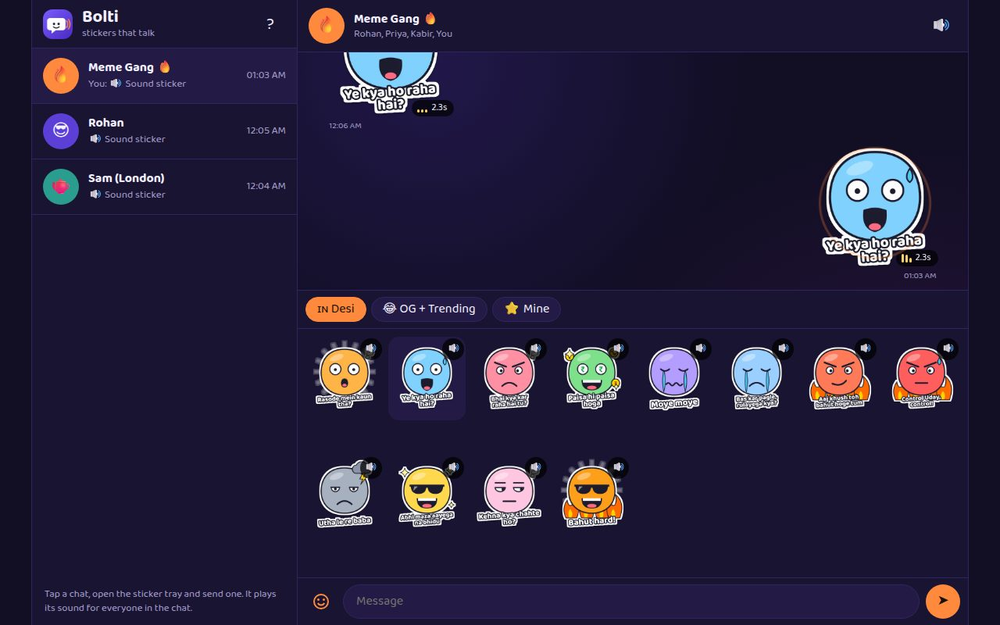
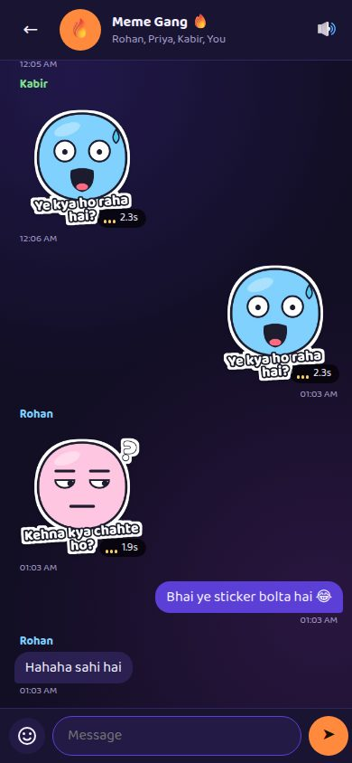

# Bolti · stickers that talk

**Sticker bhejo, awaaz ke saath.** A chat web app demo where every sticker carries its own sound.

Chat stickers are silent, and half the fun of a meme is the sound. Bolti shows one small idea: a **sound sticker** is
just a normal sticker image (512×512 WebP, the usual chat sticker format) plus a short audio clip. Send it and it plays
once for everyone in the chat. Tap it to play it again. Mute auto-play with the speaker button.

**Try it:** https://megazron.github.io/bolti/ (works on phone and desktop, installable as an app, works offline)

| Desktop | Phone |
|---|---|
|  |  |

## What's inside

- **24 built-in sound stickers** in two packs:
  - **Desi:** Rasode mein kaun tha, Ye kya ho raha hai, Paisa hi paisa hoga, Moye moye, Control Uday, Utha le re baba, Abhi maza aayega na bhidu and more.
  - **OG + Trending:** Bruh, Emotional damage, Sheeesh, Stonks, This is fine, Aura +1000, Delulu is the solulu, 6 7 and more.
- **Make your own:** pick any meme picture from your phone, add a caption, then pick a sound file or record up to
  6 seconds. It's saved on your device only (IndexedDB), nothing is uploaded.
- **Chats that reply:** demo friends answer with their own sound stickers, so you can feel the idea in a real chat.
- No accounts, no server, no tracking. Plain HTML, CSS and JavaScript.

## How the built-in stickers are made

`tools/make_stickers.py` draws each sticker (original cartoon characters, not copied meme images), speaks the line with
an offline Piper voice (Hindi or English), mixes in a synthesized sound effect (boom, dun dun dun, sad trombone,
airhorn, coins, drum roll...) and writes `app/stickers/*.webp`, `app/sounds/*.mp3` and `app/stickers.json`.
No copyrighted clips are used. Real meme clips belong to their owners, which is why "Make your own" keeps yours on your phone.

```
python tools/make_stickers.py      # needs piper, numpy, scipy, Pillow, ffmpeg, playwright + Chromium
cd app && python -m http.server    # then open http://localhost:8000
```

## Notes

- This is an independent demo of a feature idea. It is not affiliated with WhatsApp or any other messaging app.
- Code: MIT. Sounds and sticker art: CC BY-NC-SA 4.0 (the voices' licence). Font: Baloo 2 (OFL). See `LICENSE`.
